# 🌸 Bloomora – Flower Shop Mobile App UI/UX Design

Bloomora is a mobile e-commerce UI/UX design project created using Figma. It provides a simple and attractive shopping experience for users who want to explore and purchase flowers online.

## ✨ Features

- Browse flower categories: Bouquets, Roses, Lilies, Orchids, Indoor Plants, and Gift Hampers
- Explore flower products
- Product details screens
- Shopping cart and checkout flow
- Payment and user profile interfaces
- Consistent 8-point spacing system
- Mobile-first UI design and prototyping

## 🛠️ Tools Used

- Figma
- UI/UX Design
- Wireframing
- Prototyping
- Design Systems

## 🎯 Project Objective

To design an intuitive and user-friendly mobile flower-shopping experience with clear navigation and a consistent visual design.

## 🖼️ Screenshots

### 01. Splash Screen

### 02. Login Screen

### 03. Home Screen
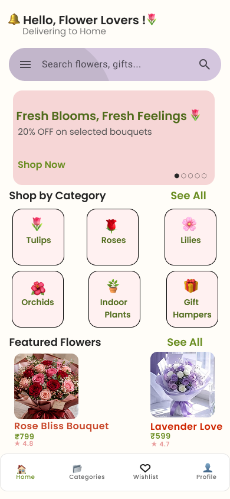

### 04. Categories
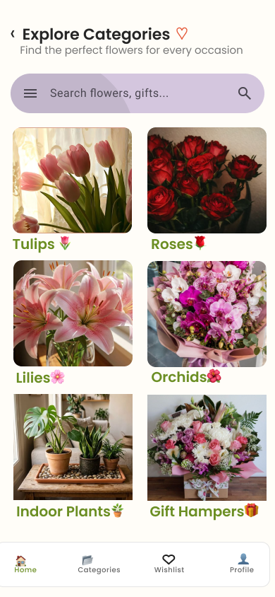

### 05. Product Listing
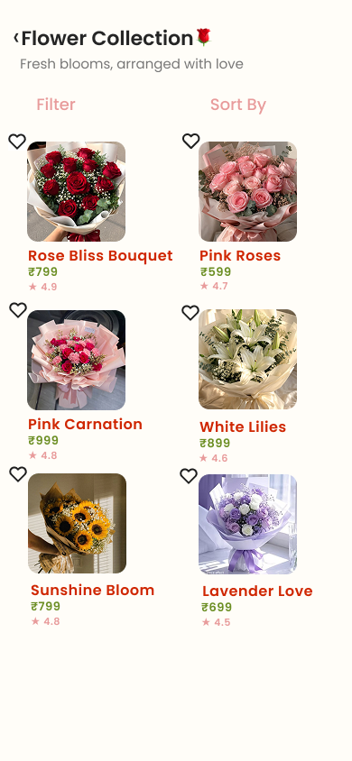

### 06. Product Details
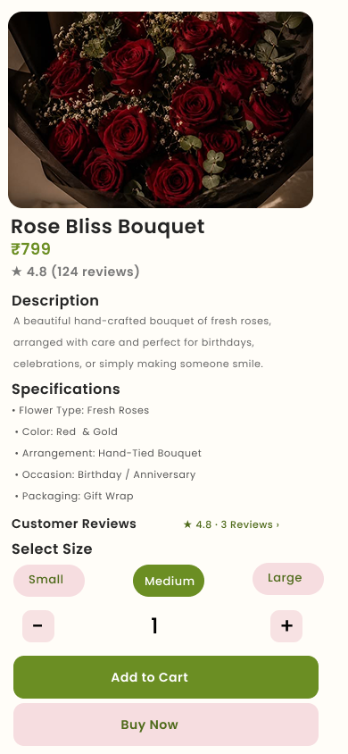

### 07. Search
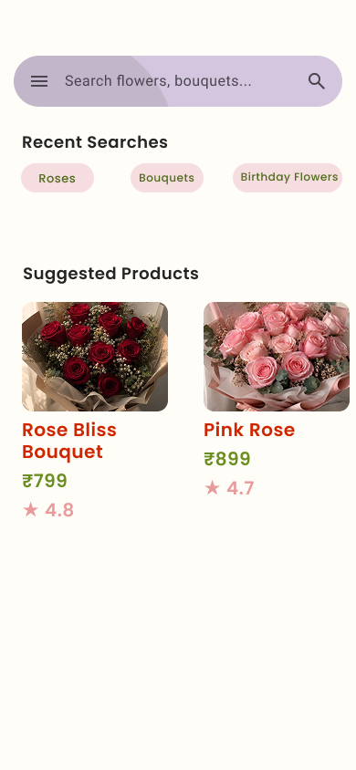

### 08. Shopping Cart
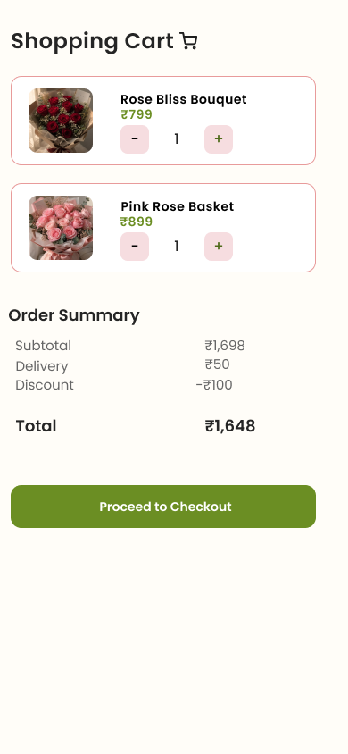

### 09. Add New Address
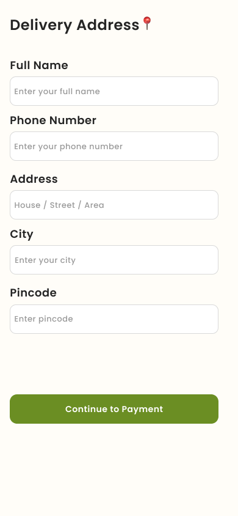

### 10. Delivery Address
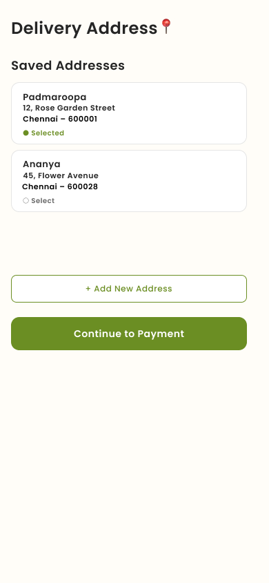

### 11. Payment
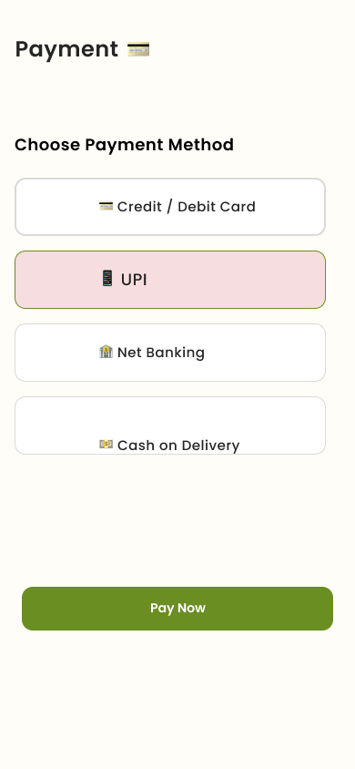

### 12. Order Confirmation
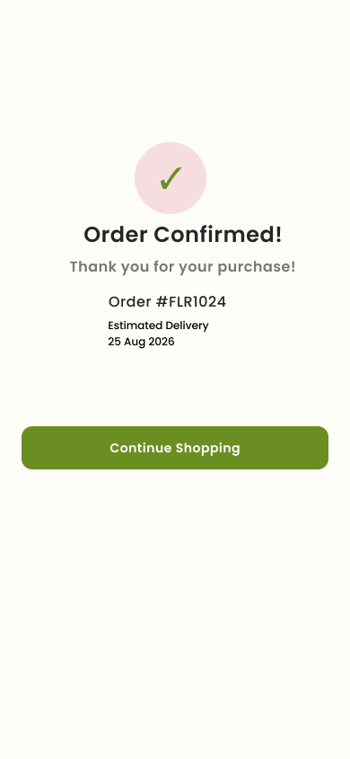

### 13. Order History
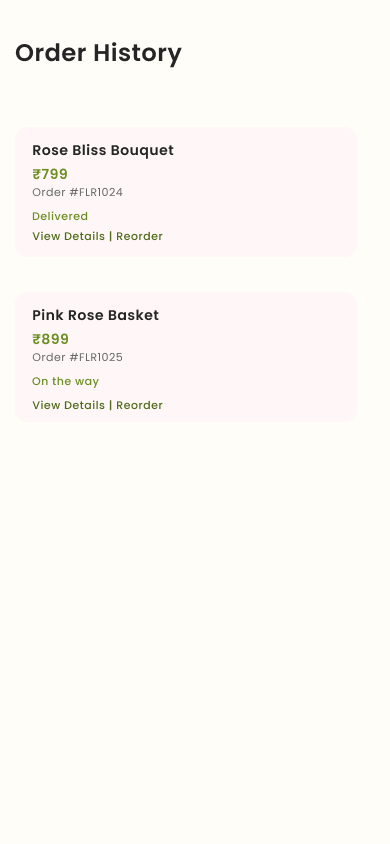

### 14. Wishlist
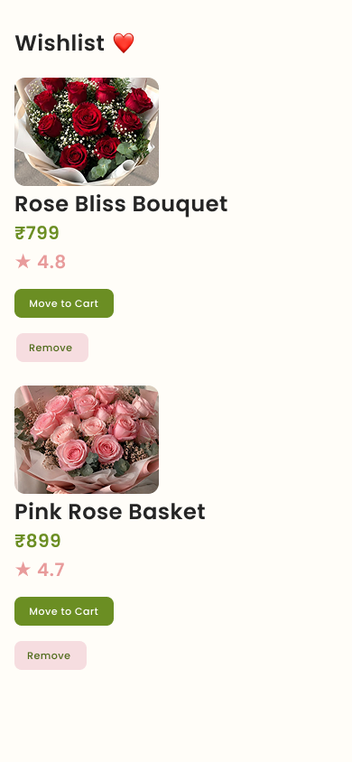

### 15. Settings
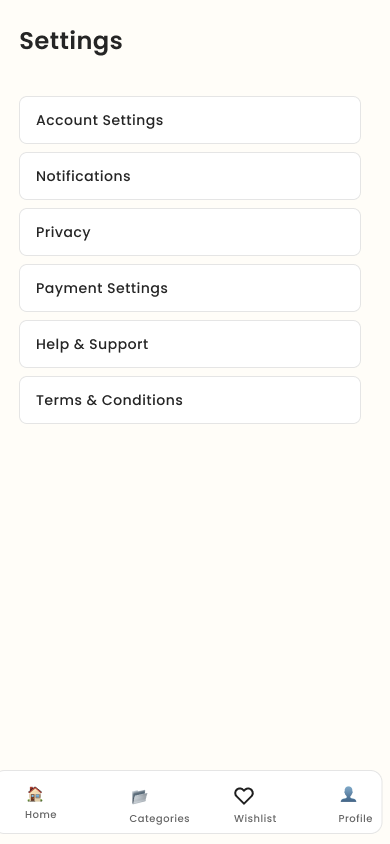

### 16. User Profile
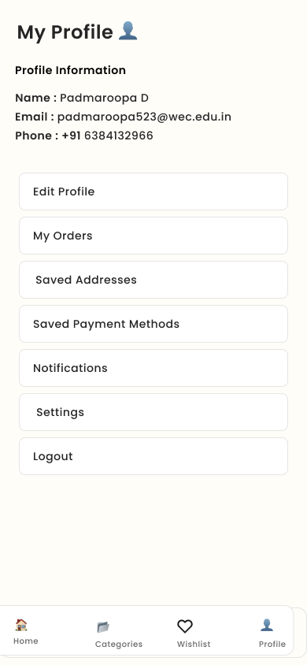

## 🔗 Figma Prototype

Explore the interactive Bloomora mobile app prototype created using Figma.

**[View Bloomora Figma Prototype](https://www.figma.com/proto/s7JtxmFFRGXmcDKbyx9kol/2303121026_Padmaroopa_UIUX_Assignment1?node-id=15-222&p=f&t=W3J5BYDr8grRMG9k-1&scaling=scale-down&content-scaling=fixed&page-id=3%3A7)

## 👩‍💻 Author

**Padmaroopa D.**
